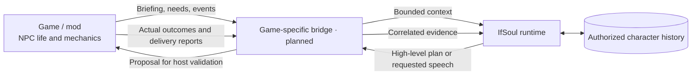
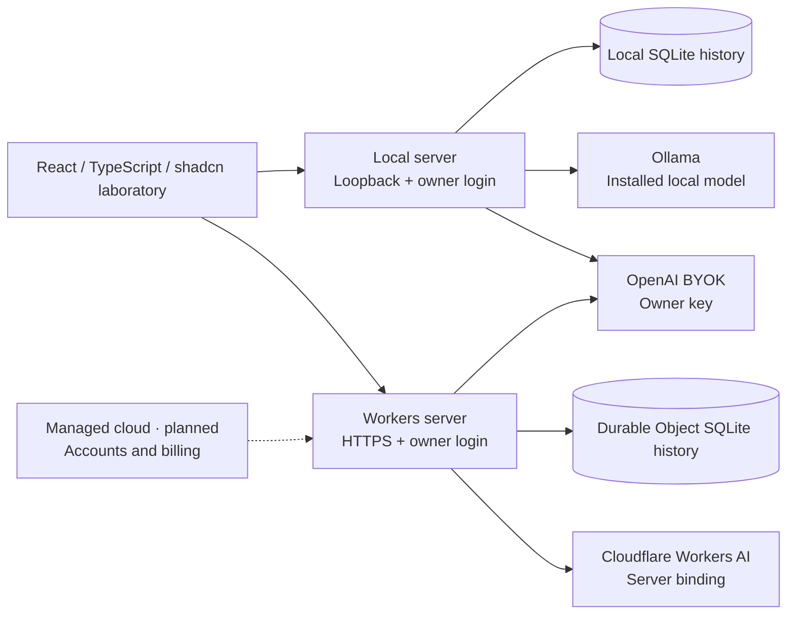
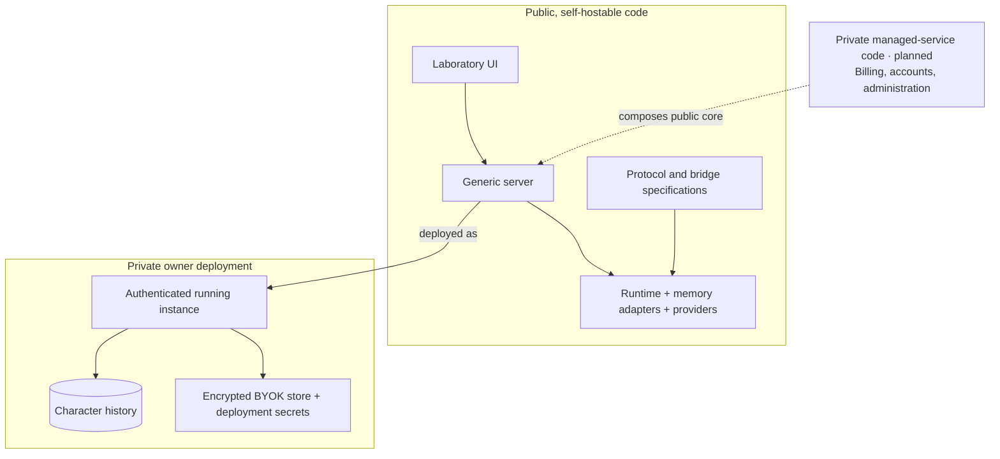

# IfSoul

**Characters should outlive their games.**

IfSoul is an experimental foundation for persistent, user-owned characters
across models, games and conversation. The intended experience is to create a
character with one model, continue with another, take that character into a game,
and later discuss permitted experiences in chat. A character may inhabit a human
or nonhuman embodiment; its portable identity and history are distinct from a
host's current body and mechanics.

This is a design goal. Data and provenance continuity do not guarantee identical
behavior or psychological identity after changing models, environments or bodies.

## Status

Source baseline: **0.1.0-alpha.1** (unreleased). See [versioning](docs/versioning.md)
and [changelog](CHANGELOG.md); protocol versions and future SDK releases are separate.

**Experimental runtime and owner laboratory.** This repository contains draft JSON Schemas,
specifications, a TypeScript runtime, SQLite event memory, a CLI and React/TypeScript/shadcn web laboratory.
The active design is [v0.2](specs/v0.2/README.md). The v0.1 schemas and examples
remain unchanged as historical regression evidence. The
[ModelProvider contract](specs/model-provider/README.md) remains independently
versioned at `draft-0.1.0`; the current clients implement a narrower laboratory API.

The original [CLI laboratory](docs/laboratory.md) remains deterministic. The
[web laboratory](docs/web-laboratory.md) adds real Workers AI, OpenAI BYOK and
local Ollama, provider/model selection and a shared server cycle. The [runtime API](docs/runtime-api.md)
is an experimental source-level interface, not a published SDK.

Game bridges, a general Character Manager, archive import/export and a managed
multi-tenant cloud product remain unimplemented. The Workers deployment is a
private owner laboratory, not a public hosted service. There is no packaged
end-user application; broader product claims below remain design goals.

## How it is intended to work

The host game or mod owns every NPC life state machine, movement, combat and
pathfinding system. IfSoul supplies bounded context-informed plans and dialogue;
a first-party bridge exchanges context and relays host outcomes. Neither
implements game skill executors or takes over the host's NPC controller.

For example, a future Project Zomboid mod could send a briefing at a configurable
game-day start, receive a high-level plan, and validate and execute that plan
through its own AI. The mod requests speech when appropriate. This is a candidate
integration requiring game-version, mod-API and license research, not supported
behavior today.

A separate live online conversation mode would allow ongoing chat. Planning
cadence and conversation mode are independent: a live model connection grants
no game-control authority. See [execution modes](docs/execution-modes.md) and
[bridge authoring](docs/bridge-authoring.md).

### A future game bridge

This is the integration contract direction, not an implemented game connection.
A body may be human, an animal or another host entity. The host advertises what
that embodiment can perceive or express; the model does not gain arbitrary controls.



Planning may happen at game-day boundaries while conversation is host-requested
or uses a separate live channel. Neither mode moves, shoots or pathfinds for the host.

## The current laboratory cycle

This sequence is implemented with the synthetic host. Real game bridges will
replace that host boundary; they are not connected today. Plans, host decisions,
execution reports and delivered replies remain different records.

```mermaid
sequenceDiagram
  actor Owner
  participant UI as Web laboratory
  participant Service as Authenticated server and service
  participant Runtime
  participant Memory as Scoped event memory
  participant Model as Selected provider and model
  participant Host as Synthetic host
  Owner->>UI: Request a plan
  UI->>Service: Authenticated request
  Service->>Runtime: Current host briefing and trusted binding
  Runtime->>Memory: Record input and select permitted evidence
  Memory-->>Runtime: Bounded history with source IDs
  Runtime->>Model: Controller requests high-level tasks
  Model-->>Runtime: Untrusted proposal
  Runtime->>Runtime: Validate scope, intents, arguments and deadline
  Runtime-->>Service: Validated proposal or safe failure
  Service->>Host: Ask for adoption of a valid proposal
  Host-->>Service: Accept/reject tasks; report actual outcomes
  Service->>Runtime: Record correlated decisions and reports
  Runtime->>Memory: Preserve intentions separately from outcomes
  Service-->>UI: Plan, host result, memory and trace
  Owner->>UI: Ask about the experience
  UI->>Service: Request dialogue with the selected model
  Service->>Runtime: Authorized conversation request
  Runtime->>Memory: Select permitted evidence from the same character
  Runtime->>Model: Controller requests reply content
  Model-->>Runtime: Reply proposal
  Runtime-->>Service: Validated reply or safe failure
  Service->>Runtime: Record transcript delivery
  Service-->>UI: Reply and updated evidence
```

### Runtime location and inference are separate choices

Solid paths are implemented. Dashed paths are future managed-service scope.
Selecting another model within one runtime preserves its character history.
Local and cloud databases are separate; changing location does not migrate data.



### Open code and private operations



The UI submits a key to the selected authenticated server but cannot read it back.
Secrets never belong in character memory or portable archives. Private source
visibility is not authentication; see [the security boundary](docs/public-private-boundary.md).

## Principles

- **Local-first:** the public local path must work without an IfSoul account or
  private repository. Offline operation requires rules or a local model.
- **Model-agnostic:** local models, BYOK network services and optional managed
  cloud are distinct deployment profiles, not different owners of the character.
  Network profiles require their own disclosure, credential and service policies.
- **Open contracts:** character, environment, context, planning, conversation,
  memory and archive boundaries are portable and versioned.
- **User-owned data:** templates differ from private instances. Preserve permitted
  memories and relationships with provenance, explicit filtering and deletion;
  keep secrets outside portable character data.

See the [product design](docs/product.md) and
[runtime profiles](docs/runtime-profiles.md) for intended scope and tradeoffs.

## Repository map

| Area                                                                                                                      | Current content                                              |
| ------------------------------------------------------------------------------------------------------------------------- | ------------------------------------------------------------ |
| [Protocol](packages/protocol/README.md) and [v0.2 specifications](specs/v0.2/README.md)                                   | Draft contracts; no SDK or transport implementation          |
| [Memory](packages/memory/README.md), [runtime](packages/runtime/README.md), [permissions](packages/permissions/README.md) | SQLite event memory and runtime; permissions package planned |
| [Adapter SDK](packages/adapter-sdk/README.md) and [model providers](packages/model-providers/README.md)                   | Planned host bridges; implemented bounded provider clients   |
| [Runtime host](apps/runtime-host/README.md) and [Character Manager](apps/character-manager/README.md)                     | CLI/shared service composition; Character Manager planned    |
| [Simulator](apps/simulator/README.md)                                                                                     | Executable synthetic host and scenario controller            |
| [Testing](packages/testing/README.md) and [contract checks](tests/contracts/README.md)                                    | Local checks; reusable conformance package remains planned   |
| [Character examples](examples/characters/README.md) and [minimal world](examples/minimal-world/README.md)                 | Original synthetic v0.1 regression data                      |

The [web laboratory](apps/laboratory/README.md) and
[owner server](apps/server/README.md) explain the current browser/server composition.

## Validate locally

Use Node.js 22.18 or later within the declared engine range and pnpm 10.15.0:

```sh
pnpm install --frozen-lockfile
pnpm check
pnpm build:web
pnpm lab:web
# Original deterministic CLI:
pnpm lab demo
pnpm lab inspect
pnpm lab chat --message "What happened in the garden?"
```

The checks need no game, model key or private repository. Installation may need
the package registry. See [development](docs/development.md) for commands and
limitations and the [execution policy](docs/deployment.md) before changing
CI or deployment. The root package is private tooling, not an SDK release.

## Design and contribution

- [Architecture](docs/architecture.md), [boundaries](docs/boundaries.md) and [decisions](docs/decisions/README.md)
- [Compatibility](docs/compatibility.md), [roadmap](docs/roadmap.md) and [contributing](CONTRIBUTING.md)
- [Threat model](docs/security.md) and [security reporting](SECURITY.md)
- [Licensing](docs/licensing.md): Apache-2.0 code/schemas, CC-BY-4.0 prose and CC0-1.0 original template data; exact scope is in the policy.

The public repository is [openifsoul/core](https://github.com/openifsoul/core).
Public local functionality must not depend on future private website or
managed-cloud code. Source availability does not imply a stable SDK release.
