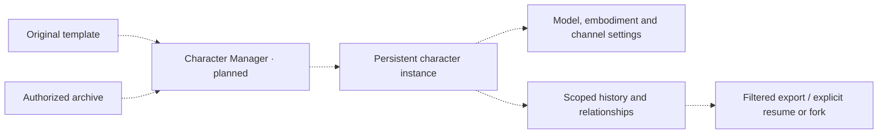

# Character Manager

Status: **planned; no implementation**. This component has no general editor, desktop app, importer or exporter.
The separate web laboratory already supplies an authenticated local/cloud panel
for manual/model-assisted profiles, a starter library, profile-only file exchange
and independent selection of local memory. A broader local web
manager with editing, archive transfer and lifecycle operations remains planned. A separate public headless
[runtime host](../runtime-host/README.md) must work without this UI.

## Input and output contracts

Inputs will be authored templates, persistent character instances and authorized
[v0.2 archives](../../specs/v0.2/README.md), local operations, trusted consent and
identity, and separately configured profiles/providers. Outputs will be views of
scoped history/relationships, configured model and environment bindings,
checkpoint/transfer decisions, complete-authorized or filtered archives, deletion
outcomes, and safe runtime status. Exact APIs are deferred; no operation works yet.

Show character identity separately from current model and body/embodiment. Games
and chat are first-class environments, and simultaneous channels need explicit
scope/communication settings. Nonhuman bodies can have constrained senses or
expression. Switching models must not imply a new character, identical behavior,
or a transfer of provider-owned chat history as the sole memory source.

Working context, episodes, long-term facts/relationships, and authored backstory
must remain distinguishable. User relations need trusted stable mapping. Plans
are intentions; acceptance is not execution, and progress requires host reports.
Do not display uncertain host outcomes as completed work. Requested-only speech
must remain off until a host/channel explicitly requests dialogue.

Resume and fork need distinct choices: resume continues one lineage after writer
handoff; fork creates a separate continuation with parent provenance. Multiple
channels may coexist under one active character-state writer, not silently create
conflicting copies. Filtered/unsupported input and unknown optional extensions
must not be silently flattened; migrations preserve the source archive.

## Ownership and imports

Permitted IfSoul imports: **`runtime`, `memory`, `permissions`, `adapter-sdk`,
`model-providers`**. The manager is a composition root that constructs/injects
implementations, trusted mappings, profiles, and budgets. The UI must not be a
core dependency or require private code/an IfSoul account. Managed hosting and
BYOK billing are separate settings from model/character identity; see
[execution modes](../../docs/execution-modes.md).

Provider keys belong to a separate protected configuration/secret store, never
archives, memory, URLs, or diagnostics. Cross-channel/remote disclosure and export
need explicit trusted policy/consent. Deletion reaches derived data/caches;
explain backup expiry/restore limits before accepting real data. The host game
owns all mechanics/state machines, movement, shooting, and pathfinding; the
manager does not provide a low-level NPC controller.

A future localhost UI/service needs per-session authentication, trusted-origin,
Host/CSRF controls, restrictive binding, and authenticated event/WebSocket
channels. Loopback alone is not authorization. See [security](../../docs/security.md).

## Criteria to begin implementation

First prove a local conversation/synthetic host harness, scoped memory, safe
archive operations, requested-only speech, provider switching, single-writer
restore/resume/fork, permissions, and deletion. Then agree concrete UI operations,
local session/key lifecycle, backup/restore policy, and deployment placement.
Validate unauthorized-session/origin rejection and safe extraction before real
data. No server build/deployment is introduced by this README.

## Planned user journey

All paths here are planned. The existing [laboratory](../laboratory/README.md)
supports profile authoring, file exchange and memory selection; it is not a general character editor or archive manager.
