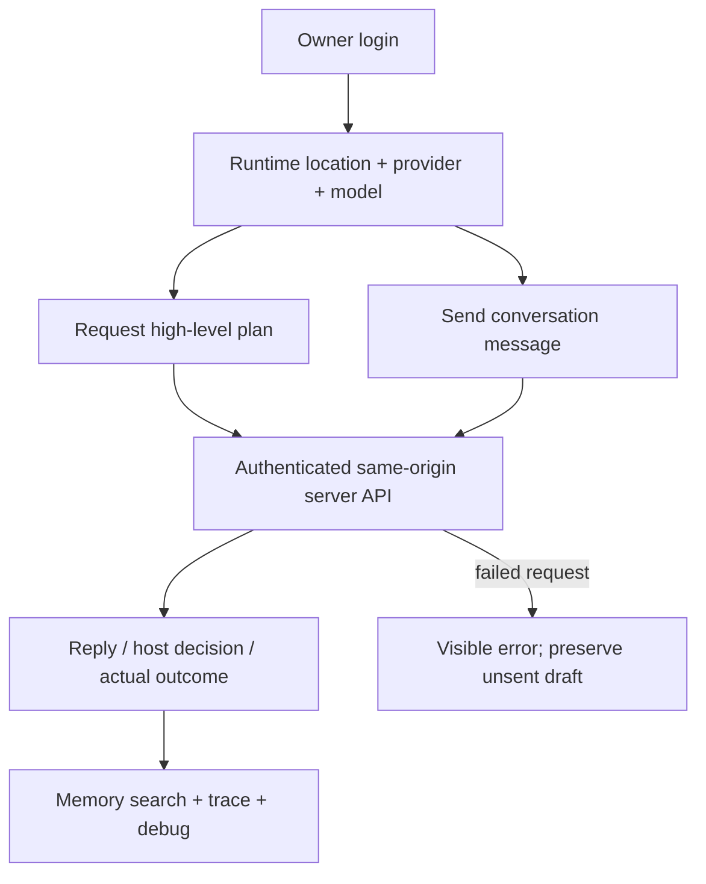

# Web laboratory

Implemented experimental React + TypeScript + shadcn panel for one owner and a
synthetic character. Choose runtime location separately from provider/model;
request plans, chat, and inspect memory and trace. This is not the planned
[Character Manager](../character-manager/README.md).

The browser imports backend types only. Keys are submitted through a write-only
form and are not stored in browser storage. Only theme and the unsent draft are
stored there. There is no automatic provider fallback. Switching runtime location
opens another server with its own login and database; it does not transfer memory.

From the repository root, run `pnpm build:web` then `pnpm lab:web` and open
`http://127.0.0.1:8788`. See the [web guide](../../docs/web-laboratory.md) for login,
model availability, recovery and current limits, and [server](../server/README.md)
for deployment boundaries.
