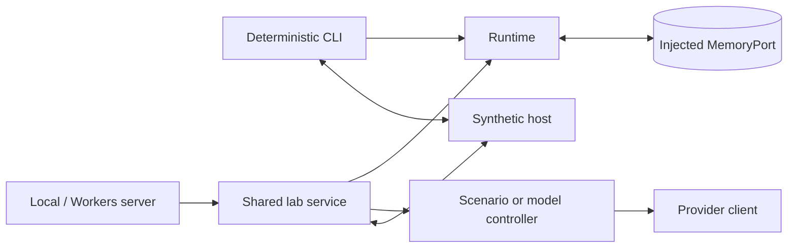

# Local runtime host

This executable composition root wires the real runtime, SQLite MemoryPort and
synthetic simulator into a local CLI laboratory. Run from core:

```sh
pnpm lab demo
pnpm lab inspect --json
pnpm lab chat --message "What did you complete?"
pnpm lab --help
```

Use `--db <path>` to choose a file, `--json` for machine-readable output and
`--full` to explicitly include original synthetic payloads in the memory listing.
The default `.local/lab/ifsoul.sqlite` is local ignored state. Every successful
open closes in `finally`; commands exit without leaving a daemon running.
Node 22.18+ may print its experimental `node:sqlite` warning to stderr.

The root supplies explicit synthetic trusted identities and recall sources; wire
participant IDs do not establish authorization. The CLI does not implement network authentication, account access, game
integration or archive import. The shared web service injects real provider
clients; the separate server owns network authentication. The fixed scenario controller is labeled in normal output.

See [the laboratory guide](../../docs/laboratory.md),
[runtime API](../../docs/runtime-api.md) and
[execution policy](../../docs/deployment.md). Checks and builds run locally; the separate server supports manual Workers deployment.

## Composition



The CLI remains deterministic. The shared service composes real providers for the
[web laboratory](../laboratory/README.md); authentication belongs to the
[server](../server/README.md), not the runtime library.
