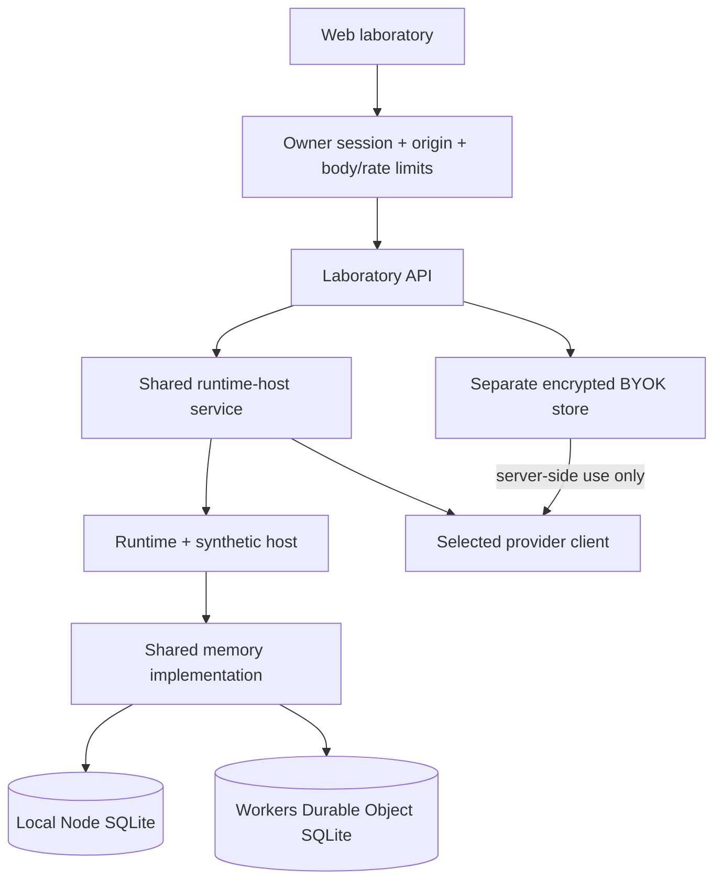

# Owner laboratory server

Implemented authenticated single-owner server, available locally on loopback or
on Cloudflare Workers. Both compose the same service and runtime. This public,
self-hostable implementation is not the future private multi-tenant cloud product.

The diagram shows deployment alternatives, not writes to both databases.
Local mode supports installed Ollama models and OpenAI BYOK; Workers supports
Workers AI and OpenAI BYOK. Both offer an explicitly synthetic scenario.
Credentials are never returned by the API or inserted into character memory.
The server sees decrypted keys while making requests; at-rest encryption does
not protect against a compromised running server.

Use `pnpm lab:web` after `pnpm build:web` for local mode, `pnpm dev:cloud` for
local Workers simulation, and manual `pnpm deploy:cloud` only after local checks.
See [execution and deployment policy](../../docs/deployment.md),
[web guide](../../docs/web-laboratory.md), and
[public/private boundary](../../docs/public-private-boundary.md).
