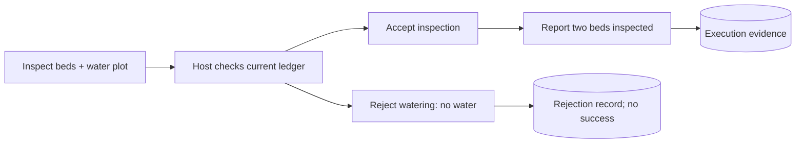

# Synthetic simulator

The executable simulator is an original, deterministic synthetic scenario. It
supplies v0.2 character/profile/context inputs, an explicitly named scenario
controller, and a tiny host-owned abstract ledger. It makes no model calls and
has no game assets, NPC life logic, locomotion, combat or pathfinding.

The controller proposes inspection and watering. The host checks its zero-water
ledger, accepts inspection, rejects watering, and changes two uninspected beds to
zero before reporting success. Acceptance never creates a completed memory.
Dialogue derives claims from selected persisted task reports and plan decisions;
missing reports leave outcomes unknown. This controller does not answer arbitrary
questions or perform rules inference.

`src/scenario.ts` owns separate original fixtures; normative v0.1/v0.2 examples
remain unchanged. The fixed simulation clock is `2026-11-05T08:00:00.000Z`,
independent of wall-clock time. Separate game/chat bindings share one portable
synthetic character and locally trusted participant with authorized source maps.

Run `pnpm lab demo` from core. See [the laboratory guide](../../docs/laboratory.md)
for commands, persistence, diagnostics and limits. The separate web laboratory also uses a synthetic host with real providers;
this package itself contains no real game integration or graphical UI.

## Host authority

This diagram illustrates the fixed CLI scenario. Real models in the web lab may
propose different tasks; the host still validates them against its own state.
