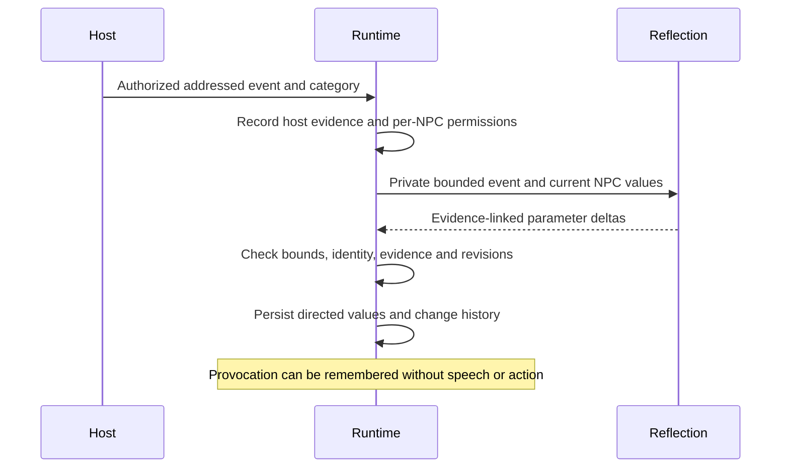
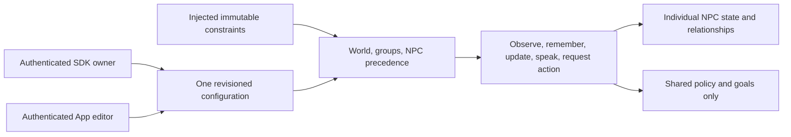
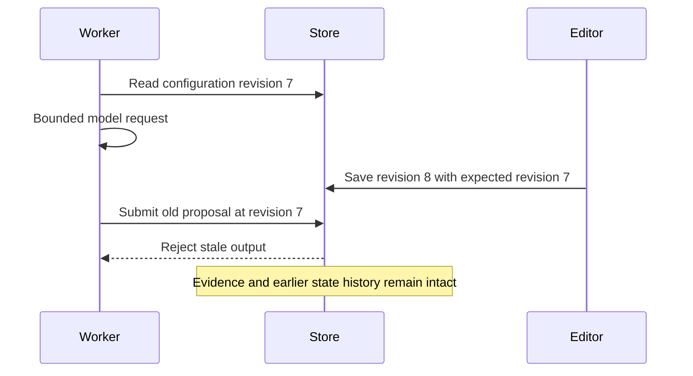

# Behavior configuration and dynamic parameters

The participant runtime separates stable authored traits, transient NPC state and
directed NPC-to-participant relationships. These values never write host-owned
health, hunger, movement, combat or pathfinding state. Host capabilities and
advertised intents remain separate from goals and reaction policy.

## One configuration, explicit owner authority

`createBehaviorRuntime` uses the existing principal-scoped `ParticipantStore`.
`BehaviorConfiguration` has the exact family `ifsoul-behavior/0.4.0`, an optimistic
revision, parameter definitions, defaults and scoped overrides. SDK and App read
and update this same persisted document; there is no separate browser config.

`DEFAULT_BEHAVIOR_OPERATOR.canEditConfig` is false. An authenticated tenant owner
must receive an explicit server-injected owner capability to read or update the
full document, operator constraints and tenant catalog. Neither host IDs, names,
imported IDs, request bodies nor model output grant this capability.

```ts
const runtime = createBehaviorRuntime(store, {
  operator: {
    ...DEFAULT_BEHAVIOR_OPERATOR,
    canEditConfig: true, // trusted authenticated owner composition only
    lockedParameterIds: ["discipline"],
    deniedPermissions: [],
  },
});
const snapshot = runtime.read(verifiedAccess);
const next = structuredClone(snapshot.config);
next.revision++;
runtime.update(verifiedAccess, snapshot.config.revision, next);
```

The owner can configure its own NPC/group/world scopes across SDK hosts. Ordinary
host inspection, observation, evidence application and generation remain bound to
the host's current session and verified members. `adminInspect` is a separate,
explicit owner-only inspection operation. Config reads do not expose another
tenant. Operator locks and denied permissions are injected separately and cannot
be changed by the editable document or model.

Effective precedence is code defaults, world override, matching group overrides
in lexicographic group-ID order, NPC override, then immutable operator denies.
Goals replace the inherited goal list; policy flags and initial values override
only specified entries. A stale edit conflicts instead of overwriting a newer
revision. Saving an earlier configuration as a higher revision changes future
policy, never stored evidence, numeric values or their history. Referenced
parameter definitions cannot be removed or change kind/scope; bounds cannot
exclude an existing value.

## Parameters, evidence and confidence

Each `ParameterDefinition` names a numeric parameter, label, kind (`trait`, `state`
or `relationship`), portable/world scope, initial/min/max/maxDelta and optional
explicit-time decay. Trust, cooperation and caution are initial relationship
presets, not a universal fixed catalog. Hosts may add other bounded definitions.
Stable traits are authored through configuration and cannot receive model deltas.
Initial values apply to new state, not a reset of existing values.

A `BehaviorProposal` pins NPC/session, configuration revision and NPC state
revision. Changes cite authorized addressed-event IDs and carry a delta,
confidence and brief evidence explanation. Relationship targets must be verified
source-session participants and actual interlocutors; self-relations reject.
Transient state changes have no participant target. Directed relationship values
stay separate for each NPC and target identity, including NPC targets.

Runtime rejects unknown fields, missing/private/cross-host evidence, unsupported
parameters, changed revisions, repeated evidence for the same value, excess deltas
and results outside min/max. Validation is atomic: no earlier change survives a
later invalid change. Values are rounded to six decimal places, not silently
clamped. Confidence is independently bounded to `[0,1]`; it is not the value.
Identical proposal redelivery is idempotent. Each accepted change records before,
after, source IDs, configuration/state revisions, confidence and reason.

Portable relationship values follow the same verified identities across world/chat
bindings. Raw evidence is not implicitly transferred between hosts. World-scoped
values and inspection history remain in their world. Explicit `decay` uses the
injected wall timestamp, moves toward the configured target by at most maxDelta
per call, records its own revision and never invents offline game actions.

## Independent reaction permissions

Policy separately controls `observe`, `remember`, `updateRelationship`, `speak`
and `requestAction`, with general and host-classified provocation settings.
The default provocation policy observes, remembers and permits relationship
updates while withholding speech and requested actions. Deterministic host rules
and source-grounded model proposals use the same validator.

Host audit evidence and NPC recall are separate: remember controls later raw
context. A current observed event may update a relationship without future raw
recall when updateRelationship permits it. A previously unobserved event never
becomes implicit model context after a policy edit. Private evidence is never a
shared group log or another character's knowledge.

Conversation and group scheduler paths check reaction rights before inference
and fence completion after configuration changes. Group planning receives common
policy/goals and explicitly shared evidence, never individual private relationship
values. A goal does not create an intent or execution authority. Plans are
proposals; only trusted host reports establish adoption and actual effects.

Resource limits use the existing trusted `resolveResourceLimits` pattern. Default
caps bound definitions, overrides, values, observations, histories, proposals and
source counts; explicit server ceilings can raise requested finite limits.
Browser or model fields cannot raise them.

Relationship interpretation and revision are model-dependent. Current validation
and persistence checks do not establish reliable semantic reassessment. The
[relationship-quality roadmap](roadmap.md#relationship-interpretation-and-revision)
remains active.

## Event and state flow



## Shared configuration



## Revision fencing


