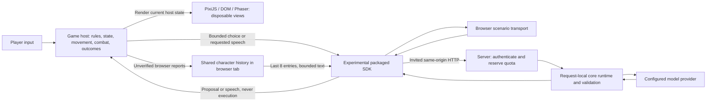

# Browser demo and bridge experiment

Status: **implemented local experiment, not a production release**. The `/demo`
page combines three original independently packaged games, a shared companion
and chat. The source implementations and standalone shells live in separate local
example repositories. Core retains a thin curated catalog and consumes public
package exports from reviewed prerelease archives. The example sources are public on GitHub; their npm packages remain unpublished.
A build alone does not establish production deployment. See
[ADR 0013](decisions/0013-independent-game-examples.md) and
[distribution provenance](../vendor/README.md). External commercial-game
integrations and a stable universal SDK remain outside scope.

The [experimental packaged SDK](../packages/adapter-sdk/README.md) uses the experimental
application transport `ifsoul-bridge/0.1`. This is separate from the frozen
[v0.2 protocol](../specs/v0.2/README.md), whose schemas and normative examples are
unchanged. The server maps a bounded bridge request into validated core runtime
planning or conversation; it does not make this HTTP envelope a new normative
protocol version. See [ADR 0011](decisions/0011-browser-demo-sdk.md).

## Playing locally

From the repository root, using the versions in [development](development.md):

```sh
pnpm install --frozen-lockfile
pnpm build:web
pnpm lab:web
```

Open [the local demo](http://127.0.0.1:8788/demo). Choose Mira, Rook or Pip, then
switch among Garden, Friendly 21, Dungeon and Just chat. Scenario mode is the
default: deterministic labeled replies run locally in the browser, require no
account and make no model request. “Free” here means no LLM inference cost.

| Game                                              | Renderer and controls                                                             | Intended visit                                                                                                |
| ------------------------------------------------- | --------------------------------------------------------------------------------- | ------------------------------------------------------------------------------------------------------------- |
| [Little orchard](../apps/demo-games/README.md)    | PixiJS vector garden; autonomous companion, Pause/Resume by pointer or keyboard   | 2–4 minutes of active simulation                                                                              |
| [Friendly 21](../apps/demo-games/README.md)       | DOM/CSS cards; Hit/Stand, H/S with table focus, or Tab/Enter                      | Five rounds, usually 2–4 minutes; player controls pace                                                        |
| [The Hollow Warden](../apps/demo-games/README.md) | Phaser vector dungeon; WASD/arrows or touch movement, Space/Attack, Shift/Ability | Three rooms plus boss; 2–4 minute target, with both roles tested at just over two minutes of simulated combat |

Game rules and progression differ. The garden accepts only bounded task-order
choices, cards accept legal hit/stand proposals, and the dungeon requests speech
only. None gives the model movement, combat, pathfinding or NPC-controller code.
All artwork and characters are original synthetic material. See the
[game catalog](../apps/demo-games/README.md).

## Ownership and data flow



The React/TypeScript/shadcn shell owns selection, chat, history and lazy mounting;
PixiJS/Phaser own only their respective game views. Each host owns mechanics and
validates current preconditions before adopting a proposal. Generated speech is
rendered as text. A proposed choice, completed host event and dialogue delivery
remain different facts.

The shell retains the last **48 combined entries per character** in this browser
tab's `sessionStorage`: game reports, user messages and agent replies share that
limit across worlds. It sends the last **8 entries** through the SDK for inference,
with additional text bounds. Switching games preserves each mounted game but
pauses inactive ones. Just chat pauses all games. Switching character destroys
the old mounts; the new character has its own bounded history. Reset visit
clears only the selected character's demo history and restarts its games.

This is not a permanent memory archive or cross-device save. Storage may be
unavailable, oldest entries are dropped, and browser history can be edited by its
user. The server treats it as unverified text, never as trusted host evidence,
identity authority or permission. Each inference builds a request-local memory
port, runs core runtime validation and clears that memory in `finally`; it does
not append the demo to the owner's permanent character archive.

## Mount, pause and cleanup

```mermaid
sequenceDiagram
  participant Shell as React shell
  participant Loader as Lazy game module
  participant Game as Host and renderer
  participant Bridge as SDK bridge
  Shell->>Bridge: Create character-bound bridge and AbortController
  Shell->>Loader: Import selected module
  Loader->>Game: await mount(container, options)
  Game-->>Shell: MountedGame
  Shell->>Game: pause() when inactive or chat selected
  Note over Game: Keep world/table state; stop host progression
  Shell->>Game: resume() when selected again
  Game->>Bridge: Bounded request or actual host report
  Bridge-->>Game: Validated proposal / labeled fallback
  Note over Game: Host checks whether response can still be adopted
  Shell->>Bridge: Abort lifetime on identity/reset/unmount
  Shell->>Game: destroy()
  Shell->>Bridge: dispose()
  Note over Loader,Game: A late mount is destroyed; late replies cannot revive it
```

Games implement the same `MountedGame` shape, but pending-request policy is
host-specific: garden defers adoption while paused; cards fence stale rounds;
dungeon speech cannot change mechanics. Destroy releases owned canvases/DOM,
input listeners and timers/frames. Local abort fences delivery and adoption;
it does not promise upstream inference cancellation, rollback or a refund.

## Authenticated model mode

Scenario play is available without authentication. Cloud LLM mode requires a
Clerk session (Google or email); local mode uses the loopback owner's identity
without Clerk. Invitations and their administration UI have been removed.
The server derives quota identity from verified authentication, never a submitted
user ID. Signing in does not expose another user's application memory or keys.

The local server uses Ollama at `OLLAMA_URL` (default
`http://127.0.0.1:11434`) and `IFSOUL_DEMO_MODEL` (default `llama3.2:latest`). The
model must already be available. The Worker uses Workers AI with the first model
in the [Cloudflare allowlist](../packages/model-providers/src/cloudflare.ts),
currently `@cf/meta/llama-3.3-70b-instruct-fp8-fast`. Application provider
selection is separate; it does not change the public demo provider. Provider
errors produce visibly labeled fallback, not a claimed successful model answer.

### Persistent limits

The authority is the exported
[`DEMO_LIMITS`](../apps/server/src/demo.ts) object, not browser controls. Counters
live in the server's private store (local SQLite or the shared budget Durable Object),
use UTC dates and survive page reload, logout, game reset and server API
recreation with the same store.

| Limit                                                      | Current value                         |
| ---------------------------------------------------------- | ------------------------------------- |
| Reservation charged before each accepted inference attempt | 24,000 reservation units              |
| Per-user daily reservation budget                          | 360,000 units                         |
| Global daily reservation budget                            | 1,200,000 units                       |
| Separate per-user/global call ceilings                     | 30 / 200 calls per UTC day            |
| Effective maximum under reservation budgets                | 15 per user / 50 globally per UTC day |
| Maximum provider output per request                        | 384 tokens                            |
| Serialized provider request cap                            | 22,000 UTF-8 bytes                    |

The `tokens` counters measure conservative fixed reservations, not reconciled
provider token usage. A durable request-ID claim and both counters are written
before inference. Successful, failed and timed-out attempts retain the entire
reservation; claims are not refunded or replayed. Invalid, unauthorized or busy
requests rejected before reservation do not spend a new claim. One in-flight
inference is allowed by this API instance. Reset visit does not call a quota-reset
endpoint and cannot replenish server allowance. UTC rollover starts new daily
counters and clears the bounded demo request-ID ledger. Demo replay protection is
day-scoped: the same request ID on a later UTC day may incur a new reservation.
Application chat separately retains its persisted completed-request results.

These are application-side bounds, **not a dollar hard-cap guarantee**. Byte
counts, reservation units, output tokens and provider billing are different
measurements. No price conversion, billing reconciliation or account-wide cost
control is implemented. Other provider usage and already submitted inference are
outside a browser reset's control.

## Standalone host and verification

The [standalone Node host](../apps/test-host/README.md) runs through the same SDK
without importing a game renderer or runtime internals. Its README describes
`pnpm demo:host` and the private `IFSOUL_DEMO_SERVER` / `IFSOUL_DEMO_TOKEN`
environment for HTTP mode. The default is deterministic scenario mode.

`pnpm test:demo` covers SDK validation/cancellation, request-local runtime
composition and the game simulations/rules. `pnpm test:server` includes authentication,
origin, reservation, replay, concurrency and quota tests. These checks do
not establish real commercial-game compatibility or production readiness.
Follow [development](development.md) for full local checks and browser QA.

Builds run locally. Hosting is Cloudflare Workers with manual Wrangler deployment
under the existing [execution policy](deployment.md). This slice introduces no
automatic deployment, remote build, publishing or package release.

## Local verification evidence

The slice was checked with the complete local `pnpm check` suite and a Workers
`pnpm build:cloud` dry-run. Headless browser checks exercised the garden through
all eight watered plants and harvested fruits (controlled browser clock), five
card rounds, Dungeon keyboard/pointer combat in both roles and room progression,
world/chat switching, per-character history, mobile layout and light/dark themes.
Full Dungeon win conditions and 2–4 minute pacing for both roles are covered by
deterministic simulation tests; a full real-time browser boss run is not claimed.

Before the authentication revision, a local invitation-based smoke test received
a real Ollama reply and confirmed reset did not replenish quota. That historical
check does not verify Clerk login. The current revision requires new authentication,
isolation and UI checks; live Clerk Google/email verification follows test-instance
configuration. Live Cloudflare inference and publication are not implied by local
checks. Test credentials and observations remain ignored local artifacts.
