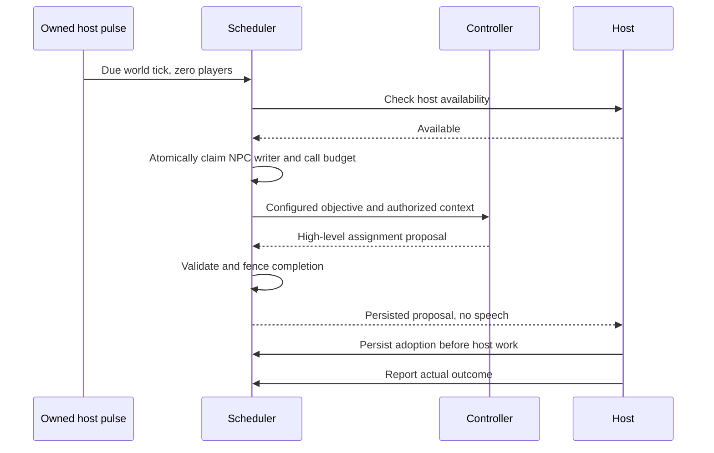
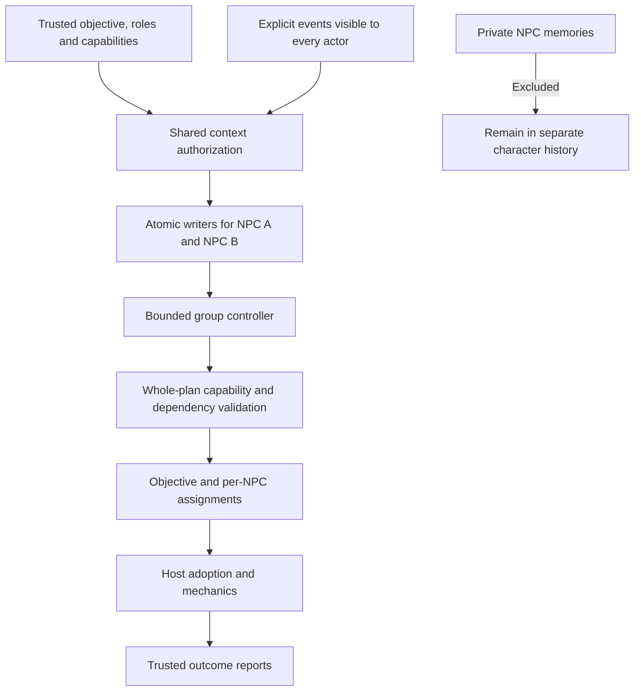
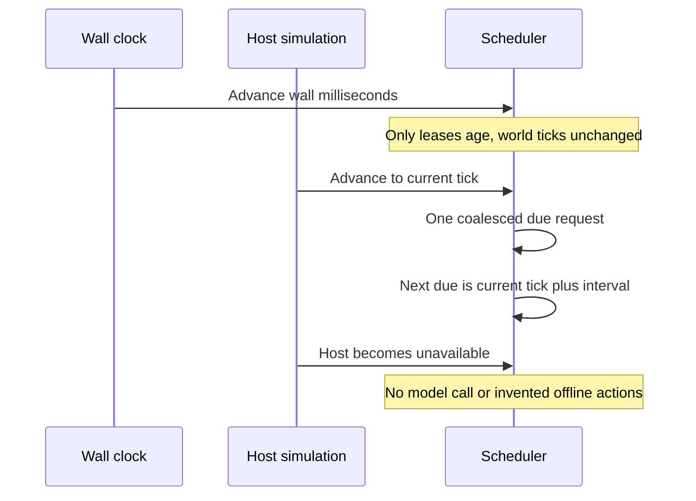
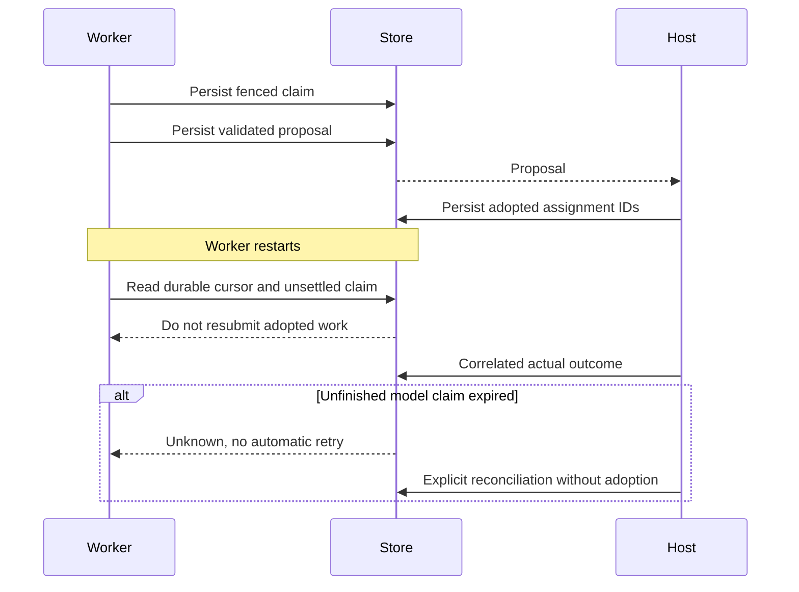

# Group planning and autonomous cadence

The participant/session runtime supports host-requested and due planning for one
or several NPCs, including sessions with no player members. The planner proposes
a common objective and per-NPC assignments. The host owns adoption, mechanics,
execution and actual effects. Planning does not grant speech rights.

## Trusted configuration and shared context

`createGroupSchedulerRuntime(store, limits?, ceilings?)` uses the same atomic
principal-scoped `ParticipantStore` as [sessions](sessions.md). A trusted root
configures `PlanSchedule` with an exact session revision, actor IDs, optional
group ID, planning roles, capabilities, advertised intents, common objective,
context channel and selected shared event IDs. Multiple actors must belong to the
named session group; every actor must be a current NPC member of the channel.
The model cannot add capabilities, roles, actors or intents.

The controller receives `PlanningInput`: the fenced claim, explicit planning spec
and selected shared events. Every selected event must have been visible to every
actor. Unknown configuration fields reject; shared event projections contain only
address, revision and text fields. Private NPC history is not automatically
recalled or attached. There is no shared group mind or implicit permission from
membership. The input context has a separate configured byte budget.

`GroupPlan` contains the exact configured objective and bounded assignments with
`assignmentId`, `actorId`, `intentId` and `dependsOn`. Each actor receives at least
one assignment. Runtime rejects the whole output for an unknown field, unsupported
actor/intent, missing role/capability, duplicate ID, missing dependency or cycle.
No assignment is adopted merely because another assignment validates. Speech,
low-level commands and model-authored effect reports are outside this output.

## Due, event and manual triggers

A schedule explicitly selects wall-clock milliseconds or host simulation ticks.
Its clock domain and session ID are fixed; use a new schedule ID to change them.
`interval` and `nextDue` use that selected unit. The injected wall clock alone
expires worker leases. Wall time never advances simulation time.

`claim` handles a due boundary, an explicit manual trigger ID, or an authorized
selected shared event ID. All triggers share the schedule cooldown and budgets.
Duplicate trigger IDs cannot create another claim. A manual/event claim also
advances the next due boundary. NPC-origin events do not bypass these rules.
The App `runDue` scans configured schedules once and starts at most one controller
call per host pulse. Missed periods coalesce into one current request, then
`nextDue` becomes the current selected time plus the interval. It never simulates
missed actions or infers offline progress.

The root supplies `hostAvailable`. An unavailable host blocks planning without
advancing its due cursor or consuming a model call. Hosts can call `runDue` from
simulation ticks or run an explicitly owned App pulse runner. Neither path needs
a player message, permanent model connection or external daemon.

## Claims, controls and host outcomes

A claim atomically reserves every selected NPC writer and a monotonic fence.
Conversation and planning share the same NPC writer journal across sessions.
Independent groups may overlap only within trusted principal concurrency limits;
actors and groups with unsettled work remain fenced. Calls count when claimed,
including failed or malformed model responses.

Pause, resume, cancel and explicit configuration updates increment the schedule
revision. Membership/host changes increment the session revision. Completion
rechecks both revisions, claim status, worker fence and wall lease before storing
a proposal. A cancelled schedule cannot resume. Controls do not clear uncertain
claims. Old results never become new memory events or host effects.

A proposal remains unsettled until the host reports. Persist an `adopted` report
**before initiating host work**. A subset may be adopted only with its dependencies.
Unselected assignments are declined. `completed` or `failed` must identify the
whole adopted subset; `rejected` declines an unadopted proposal. Only these trusted
reports establish actual outcomes. Redelivered identical report IDs are idempotent.

After a crash, a persisted active claim whose wall lease expires becomes `unknown`.
It is not automatically retried. `reconcile` explicitly acknowledges an uncertain
model attempt with no adoption; adopted work instead requires correlated host
outcome reports. Reopening a store preserves proposals, cursors, claims and reports.
This does not promise exactly-once model billing. Local cancellation does not
guarantee provider-side work or charges have stopped.

## Resource configuration

The scheduler uses Core's existing `resolveResourceLimits` mechanism through
`resolvePlanningLimits(requested, ceilings)`. Defaults include 64 principal calls,
32 calls per NPC and group, one concurrent unsettled plan, 32 schedules, 256 claims,
1024 reports and 32 runs per schedule. A claim always reserves counters before a
controller call; updating configuration never resets them.

Trusted server composition may request different finite limits and explicitly
raise its operator ceilings. Raising only a ceiling does not raise a request.
`DEFAULT_PLANNING_LIMITS` also defines actor, assignment, source-event and context
budgets. Buffered context and validation algorithms retain implementation ceilings.
Requests and model outputs cannot configure or raise this policy.

```ts
const scheduler = createGroupSchedulerRuntime(
  store,
  { principalCalls: 128, concurrentPlans: 2 },
  { principalCalls: 128, concurrentPlans: 2 },
);
```

The [App executable host](https://github.com/openifsoul/app/blob/main/apps/runtime-host/src/scheduler-demo.ts)
contains complete typed solo/group configuration and closes its runner/database.
SDK [host ports](https://github.com/openifsoul/sdk/blob/main/docs/group-scheduler.md)
preserve these types without implementing mechanics or retrying model requests.

## Solo autonomous planning



## Group autonomous planning



## Clock and cadence



## Adoption and restart



See [behavior configuration and dynamic parameters](behavior.md) for shared goals,
reaction policy and evidence-linked state.
