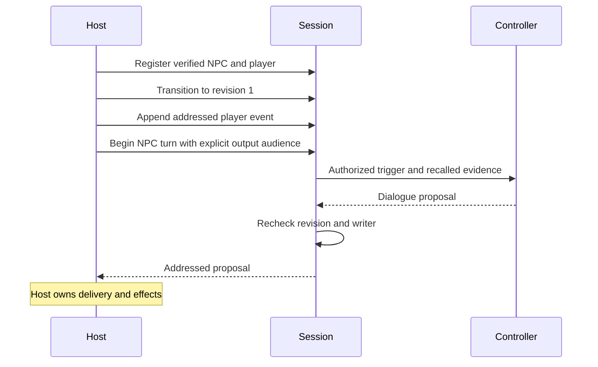
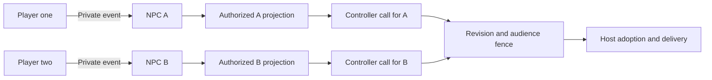
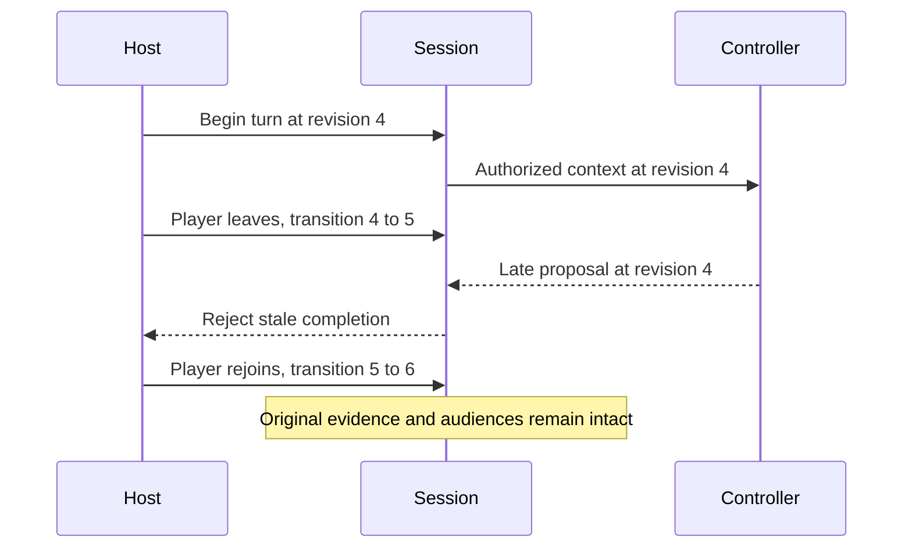

# Participants and sessions

The experimental `@ifsoul/core/runtime` participant API separates persistent
participant identity from an account, character profile, host subject and game
embodiment. A trusted composition authenticates the principal and host, resolves
verified host subjects, and calls `register`. Equal names or imported IDs never
establish identity. The same participant may join another world with a different
embodiment while retaining its verified identity.

A session has a stable `sessionId`, monotonic `revision`, host and world. Members
carry NPC/player roles; groups and channels have separate membership lists.
One or several NPCs can participate with zero, one or several players. These
configurations use the same contracts. A zero-player session still needs explicit
host events and calls. Hosts retain all adoption, mechanics and effect reporting.

`transition` atomically replaces explicit membership, roles, groups, channels,
embodiments and host ownership at an expected revision. The existing host may
hand off to a configured new host. A different world uses a new session.
Transition IDs are idempotent; conflicting payloads and stale revisions reject.
The trusted host applies its configured join/leave policy, never model text.

`append` accepts bounded addressed events with explicit sender, recipients and
observers, all currently in the named channel. Identical event redelivery reuses
the record; a conflicting ID rejects. Group membership alone grants no event
visibility. History projects only events whose original audience includes the
requested current member. Later channel/group joins do not rewrite old audiences.

`begin` pins the NPC writer, event, output audience and session revision. All output
recipients/observers must belong to the trigger audience. Before controller
invocation, recall selects events from the session's trusted `recallWorldIds`
and requires every output participant to have been in each source audience.
NPC-private evidence stays separate. A controller receives this bounded projection,
not the shared journal. A principal's single NPC writer spans sessions and service
instances sharing the atomic store. `complete` validates the pinned audience and
revision again. Membership or host changes invalidate late results. `cancel`
releases an unfinished writer without deleting its receipt or granting rights.

`relationshipEvidence` returns a source projection keyed by `npcId` and verified
`playerId`, including evidence from explicitly authorized worlds. It preserves
separate player histories through leave/rejoin and world changes. Relationship
interpretation and revision remain model-dependent; the
[relationship roadmap](roadmap.md#relationship-interpretation-and-revision) owns
that work. This API does not treat a group log as shared character memory.

Stores namespace by verified principal and must atomically commit only successful
transactions. The App composition supplies a SQL-backed implementation. Limits
bound participants, sessions, channels, events, turn receipts and text; exhausted
stores reject rather than silently discard evidence. No transport or account
system is constructed by Core.

## Solo flow

## Group flow

## Membership transition

See [group planning and autonomous cadence](group-scheduler.md) for high-level
assignment proposals and durable host-driven scheduling, including zero-player sessions.

See [behavior configuration and dynamic parameters](behavior.md) for shared goals,
reaction policy and evidence-linked state.
