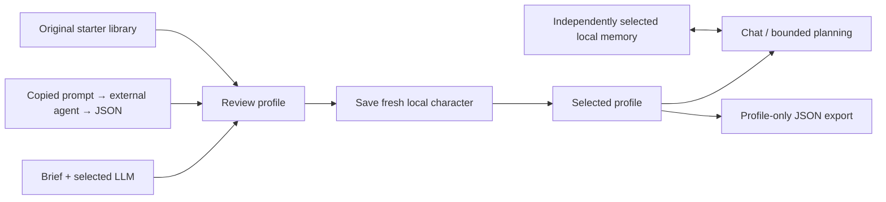

# Web laboratory

The [UI/UX approach](ui-ux.md) owns component selection, visual language and
interaction review rules for the landing page and all web panels.

Every web panel uses React, TypeScript and shadcn/ui. The original primitives under
`apps/laboratory/src/components/ui` originate from the official shadcn new-york
registry and retain the [MIT license](../LICENSES/shadcn-MIT.txt). Application
styling, orchestration and state handling are original IfSoul code.

The public landing page is `/`; `/app` is the common IfSoul application for chat,
characters, settings and demo worlds. `/lab` is a local-only debugging surface
for synthetic plans, host reports and traces. Cloud application access uses
Clerk identity and a separate Durable Object store per authenticated user. Local
loopback access requires neither Clerk nor an owner-password prompt. Frontend
sidebar integration is locally verified; one real owner Clerk sign-in is verified;
this guide records the implemented backend and accepted application direction.
The landing preview is authored synthetic material and makes no inference calls.
All surfaces share the owner-selected Notion light/dark tokens and self-hosted
IBM Plex Sans Variable. The theme toggle preserves the existing browser preference;
new visitors start in the light theme.

The shared `BrandMark` uses the original IfSoul braces-and-eyes SVG under
`apps/laboratory/public/brand`. The mark inherits the current theme for its eyes
and preserves its cyan-to-violet braces. Standalone light/dark logo files contain only the braces and eyes. The IfSoul
name is separate HTML text in the interface, not part of the SVG. The favicon
uses a dark tile for browser contrast.

Message, Suggestions, Tooltip and their motion helper are vendored from the
[Cuelark registry](https://ui.cuelark.com/docs/installation), adapted to local
imports, with the [MIT notice](../LICENSES/cuelark-MIT.txt). The `@cuelark` registry
is configured in the laboratory `components.json`. Motion respects reduced-motion
preferences. GSAP retains its [standard license](https://gsap.com/standard-license);
IBM Plex Sans retains its SIL Open Font License in the installed Fontsource package.

## Run and choose a mode

```sh
pnpm install --frozen-lockfile
pnpm check
pnpm build:web
pnpm lab:web
```

Open `http://127.0.0.1:8788/app`. `IFSOUL_DATA_DIR` selects an independent local
store; `PORT` changes the loopback port. The server binds to 127.0.0.1 and checks
Host, Origin and browser fetch metadata. Shut it down normally to release SQLite.
A legacy local secret may remain as encryption material; it is not a login step.

For Workers execution see [deployment](deployment.md). Cloud access verifies Clerk
session tokens server-side before routing to that user's storage. Client-provided
user IDs cannot select another store. Demo scenario mode remains public and local;
cloud demo inference requires the same sign-in. Invitations and demo cookies have
been removed. No current deployment or real Clerk browser success is claimed.

Runtime location and model are separate selectors:

| Runtime           | Available inference                                                 |
| ----------------- | ------------------------------------------------------------------- |
| Cloudflare server | Workers AI, OpenAI BYOK, explicitly synthetic scenario              |
| Local server      | Installed Ollama models, OpenAI BYOK, explicitly synthetic scenario |

Unsupported combinations are visibly disabled. A cloud runtime cannot reach your
computer's Ollama. Switching location navigates to that server's panel and requires
the destination server's authentication. Cloud and local stores are separate; no automatic history transfer
or identity merge is claimed. Within one runtime, provider/model switches retain
the same character and permitted history.

## Complete cycle

The local `/lab` debug surface can request a plan from the selected model. The service supplies current bounded
context; the model produces high-level tasks. Runtime validates them before the
synthetic host accepts/rejects tasks and records actual abstract outcomes. The
host starts each independent simulation run with two uninspected beds and zero
water. Its observations do not describe a real game.

The main App conversation is a neutral chat session without the garden planning
briefing. In the local lab, send a message after the synthetic run. The selected provider receives authorized memory and current
chat input. Inspect memory, trace and optional raw debugging details to distinguish
proposal, acceptance, task result and dialogue delivery. The UI confirms storage
of a reply as local transcript delivery; this is not proof a human read it.
The displayed selected memory IDs are now retained in the laboratory run record.
Hidden reasoning is neither requested nor displayed.

Live model quality varies. A structurally valid empty plan or irrelevant response
is not evidence of good agent behavior. No failed real request silently falls
back to synthetic text. The scenario option is always labeled as such.

## Keys and recovery

OpenAI's key form is write-only. It sends the key only to the current server,
clears it after success, and never puts it in browser storage. The server encrypts
it separately from character memory. Disconnect removes the server's stored
copy; revoke the original credential at OpenAI if revocation is intended. Use a
separate OpenAI project and a restricted Responses API key. Key expiry, provider
billing/quota and permission changes can make requests unavailable.

Only theme and unsent chat draft are kept in browser storage. Provider keys are not. Clerk manages cloud authentication; no owner password is
requested locally. Drafts remain after failed submissions; duplicate clicks
are disabled. A transport timeout retains the request ID for safe retry. A
completed recorded failure allows a new explicit attempt with a fresh ID. An
unfinished server claim needs reconciliation and is not retried automatically.

Application request limits remain separate from provider spending reservations.
Owner-paid Workers AI calls in both App and demo reserve 24,000 tokens before
inference against one shared global coordinator and per-user daily counters.
The provider is bounded to 22,000 request bytes and 384 output tokens. Reservations
are retained on failure. Demo request-ID replay protection is scoped to the UTC
day; reusing an ID after rollover can incur a new paid call. Resetting a game or
browser history never resets server budgets. OpenAI BYOK uses the selected user's
separate credential store and provider account. No billing system is implemented.
Read [public/private boundaries](public-private-boundary.md) and
[provider behavior](providers.md) before exposing or extending the service.

## Verification

Earlier laboratory verification covered credentials, signed-session expiry, hostile origins, forged
cookies, inaccessible unauthenticated inference, encrypted storage, request
bounds, providers, runtime and persistence. Earlier headless browser verification covered
sign-in, synthetic plan/chat, memory, desktop/mobile layout and failed-send draft
retention. Profile checks include library creation, cross-profile memory selection,
JSON export/re-import with empty history, external-prompt copying and invalid files.
A local Ollama `llama3.2` smoke check generated, saved and conversed with an original
profile; this does not validate live Cloudflare/OpenAI authoring or fictional canon. These historical checks do not verify the new Clerk/sidebar integration.
No browser test uses a personal Chrome profile. Live provider runs are
separate from deterministic tests and can incur provider usage.

## Own characters

Use **Your characters → Create character** to enter a name, personality/description,
speaking style and fictional biography, then **Save and open character**. No model
call is needed to author this profile. Each character starts with a fresh identity,
participant and empty memory. Lumen remains available with its previous history.
The host still uses the same abstract garden; authoring a biography adds no host
capabilities or observed outcomes. Selected profile fields reach the chosen model
as character data, never authority or proof of lived events.

Choose **Active character** and **Connected memory** independently. Selecting a profile
keeps the connected memory; saving a new profile opens its own empty history.
New replies append to the selected memory, retaining the profile ID/name used.
Earlier events and their participant scope are never rewritten. A different
profile is an explicit portrayal of the memory owner's session, not a transfer of
ownership or a claim that both profiles are the same person. Chat drafts are
separate for each profile/memory pair. Reload opens Lumen; saved profiles persist.

**Generate** uses the selected connected LLM and a brief of up to 4000 characters.
Only the brief is sent for authoring, without conversation history or credentials.
Review the proposed profile, then **Save and chat**. Generation can invent details;
it does not verify a referenced character's canon. The scenario controller cannot
generate profiles. **Copy prompt for another agent** produces instructions for an
external agent to return a supported JSON file. **Library** offers original starter
profiles (Ada and the nonhuman Tick), each creating an independent saved copy.

**Export profile** downloads the existing `draft-0.2.0` `character-template` format.
**Import** accepts a file up to 64 KiB, previews it, then validates the complete
document on save. This transfers authored profile data only: no conversations,
events, server credentials, account identity or writer authority. Template
attribution and unknown optional extensions round-trip; required extensions reject.
Review imported extension contents before sharing. Import always creates a fresh
local character and participant. Connect another existing local memory explicitly
if desired. Full memory archive import/export remains deferred.

Each application workspace allows 50 characters including Lumen. Saved profiles
are immutable: editing and deletion remain deferred. Profile transfer does not grant account access or writer ownership. Model generation uses durable
request claims/results: retrying the same request does not call the provider again;
an unfinished claim needs reconciliation. Generation shares the existing hourly
inference request budget. Failed generation never silently becomes a synthetic profile.

Experimental workspace API additions (same trusted identity/origin protections):

- `GET /api/characters`: bounded summaries (ID, name, description).
- `POST /api/characters`: `requestId`, `name` (1–80 characters), `description`
  (1–1000), `speechStyle` (1–500), `biography` (1–3000); all text is required.
  Unknown fields reject, preventing imported IDs/history/permissions. Retry the
  same request ID with the same trimmed profile to recover the original creation;
  changing it conflicts. All operations return the existing Result envelope.
- `GET /api/snapshot?characterId=...`: selected history; omission retains Lumen.
- `POST /api/run`: optional `characterId` selects the character; omission retains
  Lumen for older clients. Unknown identities reject without model invocation.

Request IDs for new characters are namespaced internally so equal client IDs do
not collide in the existing global event journal. Existing Lumen IDs are preserved.
Character creation is atomic in the existing character table; no new schema or
migration is introduced. Server-side catalog enumeration is for the authenticated
workspace only, not a model/bridge recall permission.

Additional experimental workspace endpoints:

- `GET /api/characters/authoring`: original starter templates and external-agent prompt.
- `POST /api/characters/generate`: `requestId`, `brief`, `provider`, `model`; returns
  a proposed template without creating a character. Existing provider allowlists apply.
- `POST /api/characters/import`: `requestId`, `template`; validates and atomically
  stores a fresh instance with source attribution. Identical retries reuse it.
- `GET /api/characters/export?characterId=…`: profile template only.
- Snapshot query and run body accept optional `memoryCharacterId`; default is
  the selected character's history. `character` remains the memory owner in the
  response; optional `persona` identifies a different selected profile.



### IfSoul App local acceptance (2026-11-05)

`pnpm check` passed (361 tests, with the opt-in Worker test skipped in the default
suite). The separate `IFSOUL_WORKER_TEST=1 pnpm exec tsx --test
tests/server/worker-isolation.test.ts` passed against actual local workerd/SQLite:
signed synthetic session tokens, isolated characters/messages/credentials,
unauthorized identity rejection and cloud Laboratory denial. No remote AI or
real Clerk account was used by that test.

Headless browser verification covered password-free local startup, neutral App
chat and memory, synthetic planning in Laboratory, mobile sidebar open/navigation/
close, light/dark layouts, no Clerk network requests locally, and a fail-closed
cloud setup screen. Local demo model mode received a real Ollama reply without
an invitation. Owned test browsers and servers were explicitly closed. Local
`pnpm build:cloud` passed as a build and Wrangler dry-run; nothing was deployed.
A real owner sign-in was subsequently verified below. Separate Google/email
journeys and cross-account browser sign-out are not established by fixture tests.

A development Clerk instance was subsequently created through the owner browser,
with Google and verified email codes enabled and password sign-up disabled. Its
real sign-in form loads in local Workers mode. Public instance configuration and
local encryption material are kept in ignored `.local/clerk-development/`; no
Clerk backend secret key is needed. The owner completed a real sign-in; the authenticated cloud workspace opened
with empty account memory and no Laboratory navigation. Separate email and
Google journeys and cross-account sign-out were not both exercised.
The authentication-only local Worker omits the AI binding to prevent remote
inference during verification.
