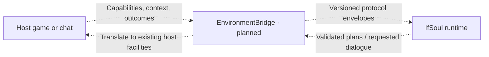

# Adapter SDK

Status: **planned; no implementation**. There is no SDK, EnvironmentBridge entrypoint,
transport, connector, game mod, chat integration, or executable handshake. The
revised [v0.2 specification](../../specs/v0.2/README.md) owns wire contracts;
[bridge authoring](../../docs/bridge-authoring.md) explains intended use.

## Input and output contracts

Inputs will be authenticated profile/identity negotiation, bounded plan proposals,
requested dialogue, and cancellation/reconciliation requests. Outputs will be
environment profiles, permitted host context, explicit full/partial adoption or
rejection, task progress/outcomes, and dialogue delivery reports. The planned
EnvironmentBridge port connects these exchanges; exact methods and transport are
not implemented. Games and chat can be environments; a chat channel can also
coexist with a game embodiment.

Profiles bind character to its environment/session/embodiment and declare
available high-level intents and expression channels. A nonhuman body may have
no ordinary speech or movement. Missing observations mean unknown, and an
advertised intent never grants permission. The host checks current restrictions,
typed arguments, context/revision/deadline, and available channels before adoption.

## Ownership and imports

Permitted IfSoul import: **`protocol` only**. This package owns a planned public
EnvironmentBridge port and shared bridge concerns. Runtime imports only the port;
independent game/chat bridges import only protocol and adapter-sdk among IfSoul
packages. They translate existing host facilities, not portable game mechanics.

**All NPC mechanics/state machines, movement, shooting, and pathfinding stay in
the host game/mod. IfSoul and its first-party bridges implement none of them.**
High-level plan intent is not an executable movement skill. No per-tick model
control loop is provided or planned.

Bridges receive only relevant authorized context, not unrestricted MemoryPort,
provider keys, or the full archive. The host can use safe autonomous behavior
while a provider is unavailable. Planning cadence and speech permission remain
separate: daily briefing never authorizes unsolicited dialogue under requested-only
policy. Future live conversation does not change host mechanics ownership.

## Outcomes and recovery

Plan delivery, full/partial acceptance, execution progress, terminal outcome,
and dialogue delivery are different facts. Report actual host evidence, preserve
unknown, and reconcile possible adoption/execution before retry. Cancellation is
not complete until the host confirms it; cancelling a wait does not roll back
the world. New sessions do not silently inherit deduplication guarantees. A fresh
ID is not an exactly-once guarantee. Respect one active character-state writer
while multiple scoped channels coexist.

## Criteria to begin implementation

Agree port methods, profiles, authenticated bindings, intent vocabulary, limits,
context freshness, lifecycle/recovery, and host fallback. Prove an in-process
synthetic host and chat trace, including unsupported/stale proposals, partial
adoption, requested-only speech, and unknown/cancelled outcomes. Before a game
bridge, separately research version/mod APIs, multiplayer constraints, and rights.
No existing project is implicitly authorized as an implementation/asset source.

## Planned bridge responsibilities

Dashed paths describe the intended SDK integration. The bridge translates and
correlates messages; the host retains execution and delivery authority.
