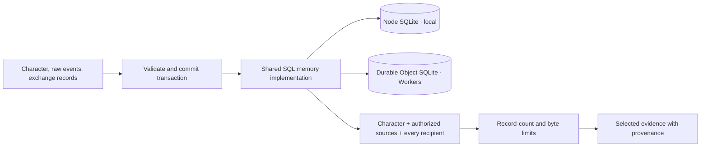

# Memory

The first **local experimental slice** provides a synchronous `MemoryPort` and
SQLite implementation using Node 22.18+'s experimental built-in `node:sqlite`.
There are no native npm addons. The port is in [`src/port.ts`](src/port.ts);
[`src/sqlite.ts`](src/sqlite.ts) exports `openSQLiteMemory(path)`.
Runtime imports only the port/helpers. A trusted composition root opens/closes
SQLite and never gives the controller unrestricted storage access.

SQLite stores immutable character instances, exchange journals and schema-checked
v0.2 raw events. Linked characters, events and exchanges commit in one transaction
or roll back together. Identical IDs are idempotent; conflicting content rejects.
Original `recordedPayload`, provenance, scope, environment/session references and
optional JSON extensions survive recording. A summary never replaces authorized
original content. Proposal/adoption records never become completed tasks.

Recall filters one character, authorized source environments, and **every**
intended audience participant before limiting records and serialized UTF-8 bytes.
Public-only recall supports publicly recorded output. The local root supplies
current identity/policy mappings; imported IDs do not grant authority. Export
policy is retained as data, without an export or consent service.

Each file database has an exclusive `<canonical-db-path>.lock` created with
exclusive filesystem open. An existing lock rejects another opener. Existing
symlinks resolve to the same path; hard-linked databases are unsupported.
Normal `close()` closes SQLite and releases its own lock; repeat close is safe.
Always close in `finally`. `:memory:` needs no lock.

After a crash a lock may remain. It is never auto-deleted based on age or PID.
An operator must verify that no live owner/connection uses the database before
manually removing that specific lock. PID reuse and network filesystems require
additional care; distributed fencing is not implemented. Do not copy or rename
an open database or lock. Local file permissions are private; encryption is not
implemented.

The runtime reserves request IDs before controller work. An unfinished claim
requires explicit reconciliation; no automatic recovery or exactly-once host
execution is promised. There is no archive importer/exporter, migration,
retention/deletion propagation, summarizer, RAG/embeddings, facts/episodes
engine, backup service, multi-writer sync or process handoff protocol. Database
tables are a local development format, not a portable archive.
See [runtime API](../../docs/runtime-api.md) and [contracts](../../specs/v0.2/README.md).

## Storage and recall

Node and Workers inject different SQL drivers into shared storage logic. These
are separate databases, not synchronized replicas. Durable raw events are implemented;
derived episodes, facts, archive transfer and deletion propagation remain planned.
