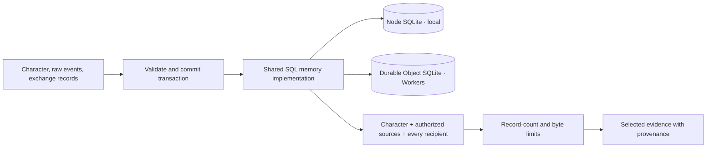

# Memory

The first **local experimental slice** provides a synchronous `MemoryPort` and
SQLite implementation using Node 22.18+'s experimental built-in `node:sqlite`.
There are no native npm addons. The port is in [`src/port.ts`](src/port.ts);
[`src/sqlite.ts`](src/sqlite.ts) exports `openSQLiteMemory(path)`.
Runtime imports only the port/helpers. A trusted composition root opens/closes
SQLite and never gives the controller unrestricted storage access.

SQLite stores immutable character instances, exchange journals and schema-checked
current 0.4.0 raw events. Linked characters, events and exchanges commit in one transaction
or roll back together. Identical IDs are idempotent; conflicting content rejects.
Original `recordedPayload`, provenance, scope, environment/session references and
optional JSON extensions survive recording. Ordinary `commit` never replaces original content. Optional trusted-owner
`compact` explicitly applies retention to nominated source IDs; see below. Proposal/adoption records never become completed tasks.

Recall filters one character, authorized source environments, and **every**
intended audience participant before limiting records and serialized UTF-8 bytes.
Public-only recall supports publicly recorded output. The local root supplies
current identity/policy mappings; imported IDs do not grant authority. Export
policy is retained as data, without an export or consent service.

Each file database has an exclusive `<canonical-db-path>.lock` created with
exclusive filesystem open. An existing lock rejects another opener. Existing
symlinks resolve to the same path; hard-linked databases are unsupported.
Normal `close()` closes SQLite and releases its own lock; repeat close is safe.
Always close in `finally`. `:memory:` needs no lock.

After a crash a lock may remain. It is never auto-deleted based on age or PID.
An operator must verify that no live owner/connection uses the database before
manually removing that specific lock. PID reuse and network filesystems require
additional care; distributed fencing is not implemented. Do not copy or rename
an open database or lock. Local file permissions are private; encryption is not
implemented.

The runtime reserves request IDs before controller work. An unfinished claim
requires explicit reconciliation; no automatic recovery or exactly-once host
execution is promised. There is no archive importer/exporter, migration,
backup/third-party deletion propagation, summarizer, RAG/embeddings, facts/episodes
engine, backup service, multi-writer sync or process handoff protocol. Database
tables are a local development format, not a portable archive.
See [runtime API](../../docs/runtime-api.md) and [contracts](../../specs/current/README.md).

## Storage and recall

Node and Workers inject different SQL drivers into shared storage logic. These
are separate databases, not synchronized replicas. Durable raw events are implemented;
App composes deterministic extractive episodes through the generic retention port;
Core has no host-specific episode semantics, facts engine or archive transfer.
App owns bounded episodes, source-validated revisable interpretations and bridge
reset; see [App memory architecture](https://github.com/openifsoul/app/blob/main/docs/memory.md)
for the evidence flow and API limits.

The trusted owner composition can enumerate at most 100 immutable character
documents using `listCharacters(limit)`. This experimental MemoryPort addition is
for the owner catalog, not scoped model recall; do not expose it to a controller
or bridge. The laboratory applies its own creation cap of 50.

## Optional atomic retention

`MemoryPort.compact` is an experimental source API, not a frozen wire/schema
change. Older adapters may omit it; owners must report unsupported retention.
The trusted single writer names exact source event/exchange IDs and replacement
records. Event sources must exist inside the nominated character, environment
and exact scope; replacements remain in that same partition. Exchanges are
owner-wide records with no environment field: callers must select only their own
categories/IDs and never unrelated runtime request claims or paid ledgers. This
method is never exposed to a model, browser or game host.

Validation and deletion/replacement execute in one synchronous transaction.
Conflicting/missing sources or invalid replacements reject; failures roll back
originals. Repeating an identical completed batch succeeds idempotently. Source
selection and compaction must run without an asynchronous gap under the existing
single-writer policy; this API is not a multi-writer lease or optimistic revision
protocol. It does not vacuum SQLite files, erase backups or propagate deletions.
Callers own retained excerpts, source digests, loss disclosures and rebuild policy.

## Retained event inspection

The optional trusted-owner `MemoryPort.scan` pages through event envelopes in
storage insertion order. The caller provides the owner memory ID and the complete
set of participant IDs it is authorized to inspect. A private or participant
record is visible only when every recorded recipient is in that set. Exchange
journals and controller state stay outside the scan.

The SQL adapter returns a high-water anchor and continuation sequence. Continue
with that anchor to exclude later writes. If the anchor is removed or its scope is
no longer visible, restart the scan. A caller-supplied reset marker excludes
earlier events in its environment on every page. The local SQLite adapter uses an
additive owner/sequence index. Each call reads up to 128 event envelopes and limits
the selected document bytes to 512,000, allowing a single larger envelope to make
progress. Adapters may omit the inspection method.

The SQLite owner scan accepts an optional full-text phrase. It matches retained
canonical event documents using SQLite FTS5 Unicode tokenization. Search totals
count authorized events within the cursor anchor and active reset partition.
Applications that project multiple records from an event must distinguish this
candidate event count from the count of projected records. Drivers without
full-text support return an explicit unsupported result for text searches.
