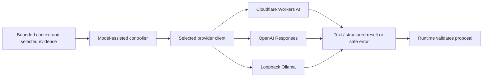

# Model providers

The experimental laboratory now has real bounded text-generation clients for
Cloudflare Workers AI, OpenAI Responses and a configured loopback Ollama daemon.
They use injected `fetch` or a Workers AI invoke function, without a vendor SDK.
No client reads environment variables, opens storage, or imports runtime/game
code. Credentials stay in the trusted root/client closure and transport headers.

[`src/index.ts`](src/index.ts) exports `createOpenAIProvider`,
`createCloudflareProvider`, `createOllamaProvider`, model allowlists/defaults and
local callable types. These callable APIs do not implement the separately named current ModelProvider
JSON specification as a serialized transport or claim its entire tool surface. See [provider API and current
verification](../../docs/providers.md).

Each client returns a safe discriminated result, bounds request/response bytes,
output tokens and the entire asynchronous wait, propagates cancellation and
rejects incomplete/malformed output. OpenAI/Cloudflare models are allowlisted;
Ollama discovers installed names through `/api/tags` and calls `/api/chat` without
pulling models. Remote URLs, redirects and known cloud/embedding models are
excluded from the Ollama path. There is no silent provider/model/scenario fallback,
automatic retry, streaming UI or billing/account-access guarantee.

The service's runtime-owned controller adapter supplies selected character,
context, intent catalog and memory, asks the model only for plan tasks or reply
content, and stamps every envelope/correlation/time field itself. Normative
schema and semantic checks still gate host adoption/delivery. A model response
has no execution authority and is not automatically true. The character and
history remain independent of the selected provider/model.

The explicit `scenario` choice uses a labelled deterministic controller, not a
real model client. Timeouts/cancellation cannot prove zero upstream compute or
billing. Unknown token usage remains unknown. There is no token/cost ledger,
provider session ownership, key export, arbitrary tool executor, or low-level NPC
controller. Deployment/authentication and key provisioning belong to composition.

## Inference boundary

Only the selected provider is called. Provider/model selection changes inference,
not character ownership. No client receives unrestricted memory or game authority.
