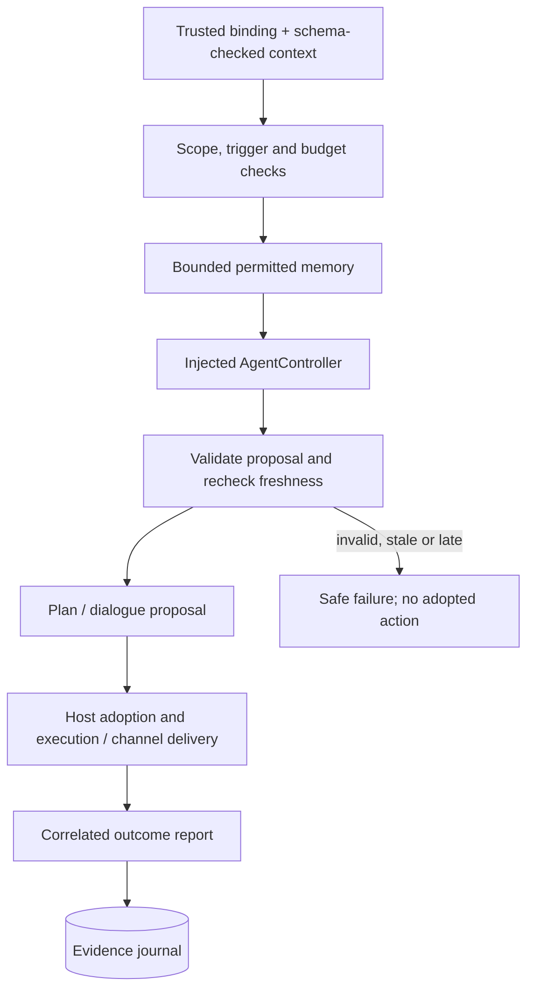

# Runtime

The first **local experimental slice** orchestrates bounded host plans and
requested conversation through an injected `AgentController` and `MemoryPort`.
It validates the current 0.4.0 contracts and selected semantics, records raw events,
and correlates host adoption, execution reports and dialogue delivery. Provider clients and local/Workers servers are composed outside this package;
the runtime is not a published package.

[`src/index.ts`](src/index.ts) exports `createRuntime`, `exchangeKey`, and the
types in `src/types.ts`. See [callable API](../../docs/runtime-api.md) and the
[synthetic laboratory](../../docs/laboratory.md). Runtime imports the memory
port/helpers; it never constructs SQLite or exposes a store to the controller.

`setSession` takes an explicitly trusted local mapping plus schema-checked
character, profile and context. Imported participant links do not authenticate
anyone. Runtime checks binding/revisions, allowed host intents, exact typed
arguments, visible entities, quantity/choice bounds, task count and dependency
DAG. It rechecks context/deadlines after asynchronous controller work.
Conversation checks trigger, verified participants, channel and embodiment
modality before invocation, then validates correlated output. Planning does not
trigger speech. Recall includes every direct and recorded-output recipient;
publicly recorded output receives only public source memories.

Only host decisions adopt tasks; only correlated reports for accepted tasks
become execution evidence. Proposal, adoption and delivery acceptance remain
distinct from completed work or delivered speech. Reports remain individual raw
observations; there is no last-write-wins task-state projection or assumption
that model text is true.

Durable claims precede controller calls. Identical completed requests reuse the
recorded result while valid; conflicting IDs reject. Unfinished claims require
explicit reconciliation instead of retrying after a crash. Timeouts return even
when an asynchronous controller ignores AbortSignal; late results cannot record
proposals. Injected synchronous code can block the JavaScript event loop: this
is not a sandbox.

Limits cover calls per runtime instance, document bytes, selected memory count
and bytes, context age and wait time. Safe traces contain stages/IDs/statuses,
never raw upstream errors, prompts or hidden reasoning. This package does not own providers; no
scheduler, cancellation exchange, archive import/export, migration, checkpoint
resume/fork, deletion propagation or network authentication is implemented.

Host games/mods retain all NPC state machines, movement, combat and pathfinding.
Runtime proposes data for an existing host facility; it does not implement one.

## Decision and evidence flow

The runtime is orchestration, not a game engine or secret store. The same boundary
applies to a deterministic strategy, a model-assisted controller or a future external agent.
